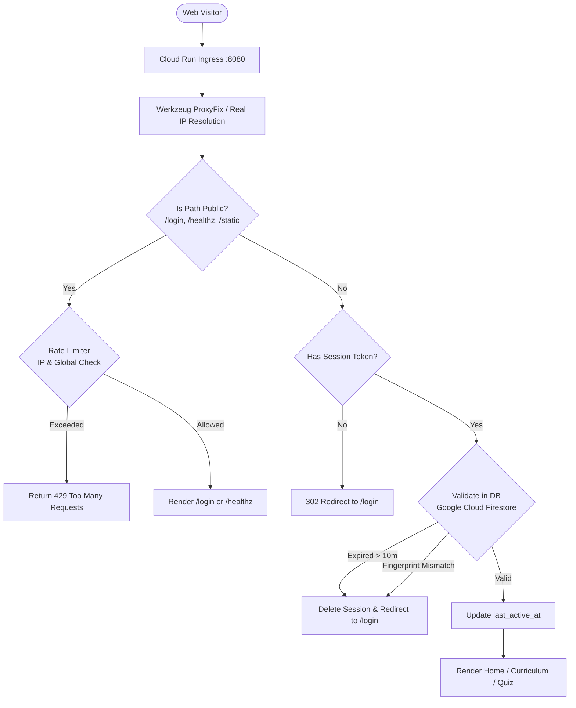

# Python Roadmap (`py-rm`)

> **"I made this to help my brother learn Python. Only users created by me can login."**  
> **Live Production URL:** [https://learn-python.cloud.run](https://learn-python.cloud.run)

---

## 📖 Executive Summary & Mission

`py-rm` is a personalized, distraction-free learning platform engineered specifically for a 13-year-old beginner starting his programming journey. 

Unlike public learning platforms that are noisy or saturated with social features, `py-rm` is private, structured, and goal-oriented. It delivers bite-sized milestones featuring:
- **Curated Topics**: Core Python fundamentals explained in clean, beginner-accessible language.
- **Handpicked Video Lessons**: Embedded YouTube tutorials to watch directly on the platform without YouTube recommendation distractions.
- **Interactive Checklists**: Real-time progress tracking to maintain momentum.
- **Quizzes**: Fun checkpoints to validate mastery after each module.

To protect the platform and ensure a focused environment, there is **zero public registration**. The application is locked behind a strict authentication barrier: the `/login` screen is the sole entry point exposed to the open internet.

---

## 🛠️ Technology Stack & Architecture

| Layer | Technology | Rationale & Architectural Benefit |
| :--- | :--- | :--- |
| **Backend Framework** | **Python 3.12 + Flask** | Written in the very language he is learning, turning the codebase into an educational artifact. Flask is lightweight, explicit, and fast to run. |
| **Frontend & UI** | **Jinja2 + Tailwind CSS** | Server-side rendered pages guarantee that unauthenticated visitors never receive internal HTML or data payloads. Styled with modern dark-mode components. |
| **Database Engine** | **Google Cloud Firestore (Native Mode)** | Serverless NoSQL document database. Zero configuration on Cloud Run, scales to zero with **\$0 idle cost**, and stays within GCP's permanent free tier (1 GB storage, 50k reads/day, 20k writes/day). Full persistent state with zero SQLite dependencies. |
| **Content Store** | **YAML / JSON** | Curriculum topics, video links, checklist items, and quiz questions live as structured repository files for easy version control without database migrations. |
| **Hosting & Compute** | **Google Cloud Run** | Fully managed serverless container runtime deployed in `asia-south1 (Mumbai)`. Configured with `max-instances=1` to guarantee cost control. |
| **WSGI Server** | **Gunicorn** | Production-grade WSGI server running with 1 worker and 8 threads for low memory usage and high concurrency. |
| **Containerization** | **Docker** | Uses `python:3.12-slim` for tiny container footprint, predictable builds, and fast Cloud Build deployments. |

---

## 🏛️ System Architecture & Request Lifecycle



---

## 📜 Step-by-Step Build Chronicle

This project was built incrementally, addressing cloud constraints, security boundaries, and architectural resilience at each milestone.

### Phase 1: Core Web Engine & Authentication Prototype
1. **Virtual Environment & Dependencies**: Initialized `.venv` with Python 3.12, pinned production dependencies (`Flask`, `Flask-Limiter`, `gunicorn`, `werkzeug`, `python-dotenv`).
2. **Reverse Proxy Integration**: Integrated `werkzeug.middleware.proxy_fix.ProxyFix` to correctly parse `X-Forwarded-For` and `X-Forwarded-Proto` headers behind Google Cloud's load balancers.
3. **Password Security**: Passwords are never stored in plain text. Implemented **scrypt** cryptographic hashing via `werkzeug.security.generate_password_hash`.
4. **Admin User Management CLI (`manage.py`)**: Built an administrative command-line utility to provision user credentials (`create-user`, `list-users`, `init-db`) without needing a web registration form.
5. **UI & Templates**:
   - `templates/base.html`: Common layout with Tailwind CSS loaded via CDN, custom dark palette (`bg-slate-950`), and floating notification flash banners.
   - `templates/login.html`: Distraction-free login card with username and password fields.
   - `templates/home.html`: Welcoming home screen displaying **"Hello!"**, the logged-in username, and a logout button.
6. **Containerization**: Authored a lean `Dockerfile` based on `python:3.12-slim` running Gunicorn on port `8080`, alongside a `.dockerignore` to keep repository build layers minimal.

---

### Phase 2: Google Cloud Run Deployment & Live Setup
1. **GitHub Connection**: Pushed codebase to `git@github.com:aourabindorout/py-rm.git`.
2. **Cloud Run Provisioning**:
   - **Service Name**: `py-rm`
   - **Region**: `asia-south1 (Mumbai)` for ultra-low latency.
   - **Authentication**: Set to *Allow unauthenticated invocations* (public access to container port `8080` so the public can hit the `/login` gateway; internal routes remain guarded by Flask).
   - **Billing Model**: *Request-based* (scales to 0 when idle so costs remain \$0).
   - **Critical Bill-Shock Guardrail**: Hard-capped **`max-instances = 1`**. Even under automated DDoS traffic, Cloud Run is forbidden from spinning up additional instances.
3. **Live Deployment**: Service went live at **`https://learn-python.cloud.run`**.

---

### Phase 3: Login Guardrails & Abuse Defense
To prevent automated credential stuffing, bot scraping, and billing spikes from internet crawlers:
1. **Application-Level Dual-Tier Rate Limiting (`Flask-Limiter`)**:
   - **Cost-Effective In-Memory Storage (`storage_uri="memory://"`)**: Rather than running a dedicated Redis instance (like GCP Memorystore at ~$35–$50/month with zero scale-to-zero capability), rate-limit counters are kept in container process memory. Paired with `max-instances=1`, this delivers effective burst and brute-force protection at **$0.00 infrastructure cost**, with the conscious architectural trade-off that counters reset when the container scales down to zero.
   - **`POST /login` (Credential Stuffing Defense)**:
     - **3 attempts / minute per IP**
     - **15 attempts / minute per instance ceiling**
   - **`GET /login` (Scraping & Flooding Defense)**:
     - **3 requests / minute per IP**
     - **25 requests / minute per instance ceiling**
2. **Custom Error UI (`templates/429.html`)**: Rate-limited visitors receive an informative HTTP 429 page explaining the cooldown period with a reload action.
3. **Timing-Attack Mitigation**: Rate limits evaluate *before* password hash computations, preventing CPU exhaustion attacks.

---

### Phase 4: Server-Side Session Tracking & Expiry Controls
* **The Vulnerability**: Flask's default sessions are stateless client-side signed cookies. If an attacker copied an active session cookie on another machine, clicking "Log Out" only deleted the cookie on the user's browser—the stolen cookie string remained cryptographically valid until expiration.
* **The Fix**:
  1. **Server-Side Session Store**: Created a `sessions` collection tracking `session_token`, `user_id`, `user_agent_hash`, `created_at`, and `last_active_at`.
  2. **Instant Revocation on Logout**: Clicking **Log Out** immediately purges the session token from the Firestore database, rendering the cookie completely dead on the server.
  3. **10-Minute Inactivity Expiry**: Sessions enforce a sliding 10-minute inactivity window. If no requests are made for 600 seconds, the session auto-expires and is deleted from the database.
  4. **User-Agent Consistency Check**: Compares the client's `User-Agent` against a SHA-256 hash stored at login. Serves as a defense-in-depth heuristic against unsophisticated script replay or accidental token sharing between different browsers. (Note: As an HTTP header, `User-Agent` is client-controlled rather than hardware device authentication; an attacker with full request control can spoof it).

---

### Phase 5: Google Cloud Firestore Integration
1. **IAM Permissions**: Attached the `Cloud Datastore User` role to the Cloud Run Compute Service Account (`<project-number>-compute@developer.gserviceaccount.com`).
2. **Firestore Provisioning**: Created the `(default)` database in **Firestore Native Mode**, Standard Edition, located in `asia-south1 (Mumbai)`.
3. **Data Model Architecture**:
   - `users/{username}`: Direct document key lookup for $O(1)$ authentication checks.
   - `sessions/{session_token}`: Direct document key lookup for active session validation.
   - `progress/{username}`: Persistent storage for `completed_topics`, `checklist`, and `quiz_scores`.

---

### Phase 6: Advanced Hardening & Vulnerability Remediation
1. **Cryptographic `SECRET_KEY` Management**:
   - In production, `SECRET_KEY` should be set as a persistent environment variable in Cloud Run to prevent user cookies from being invalidated during container cold starts.
   - If omitted, a dynamic 256-bit cryptographic key fallback is generated on startup (`secrets.token_hex(32)`) and a warning is logged.
2. **Hardened `SESSION_COOKIE_SECURE`**:
   - Automatically detects Cloud Run (`K_SERVICE`) or production environments and enforces `SESSION_COOKIE_SECURE = True`, guaranteeing that session cookies are only transmitted over encrypted HTTPS channels.
3. **Strict User-Agent Verification**:
   - Requests omitting or falsifying the `User-Agent` trigger immediate session revocation.
4. **CSRF Protection on Sensitive Endpoints**:
   - Added synchronizer CSRF tokens (`session["csrf_token"] = secrets.token_hex(32)`) and `secrets.compare_digest` verification across all state-changing endpoints (`/logout`, `/admin/create-user`, and `/admin/delete-user`).
5. **Emoji Favicon**: Inline SVG data-URI favicon (`🐍`) with zero external asset dependencies.

---

### Phase 7: Pure Firestore Migration & Web Superuser Dashboard (`/admin`)
1. **100% SQLite Elimination**:
   - Completely purged `import sqlite3`, `instance/py_rm.sqlite3`, and SQLite fallback branches from `db.py` and `manage.py`.
   - Removed ephemeral filesystem directory creation (`RUN mkdir -p /app/instance`) from `Dockerfile`.
   - All environments (Cloud Run and local dev) communicate directly with Google Cloud Firestore, permanently eliminating container cold-start data loss and split-brain states.
2. **Role-Based Access Control (`is_superuser`)**:
   - User and session schemas store `is_superuser: bool`.
   - Replaced legacy `ADMIN_*` environment variables with `SUPERUSER_USERNAME` and `SUPERUSER_PASSWORD` for deterministic superuser auto-seeding.
3. **Web-Based Admin Dashboard (`templates/admin.html`)**:
   - Accessible only to superusers via `@require_superuser` (unauthorized visitors receive `403 Forbidden`).
   - Renders live user roster, role badges, creation timestamps, and student progress metrics (completed topics, checklist items, quizzes passed).
   - In-app **Create User** form with automatic password hashing.
   - In-app **Delete User** action with anti-CSRF protection, automatic session invalidation, and self-deletion prevention guards.
4. **Cascading User Deletion (`delete_user`)**:
   - Deleting a user purges their Firestore user doc, revokes all active session documents immediately, and cleans up progress data.
5. **Firestore Activity Write Throttling (60-second sliding update)**:
   - To eliminate redundant database operations on every single page load, `validate_and_refresh_session` throttles `last_active_at` writes to once every 60 seconds (`ACTIVITY_UPDATE_INTERVAL_SECONDS`).
   - Cuts Firestore write volume by 90–95%, significantly improves page load latency by removing database writes from the request hot path, and protects daily free quotas.
6. **Local Authentication Bridge**:
   - Automatically auto-detects `gcp-key.json` locally while strictly ignoring it in `.gitignore` and `.dockerignore` to prevent credential exposure.
7. **Isolated Test Harness**:
   - Refactored `test_auth.py` to create and tear down scoped test accounts (`tester`, `admin_tester`, `created_student`), enabling automated testing against Firestore without touching real student or superuser accounts.

---

### Phase 8: Interactive Python Curriculum, Video Lessons, Checklists & Quiz Engine
1. **YAML Curriculum Engine (`curriculum.yaml` & `curriculum.py`)**:
   - Structured 8 beginner-friendly Python modules (Setup & `print()`, Variables & Strings, Numbers & Input, Lists & Tuples, Dictionaries, Conditionals, Loops, and Functions & Number Guessing Game).
   - Stored in YAML (`PyYAML`) so `.dockerignore` can safely continue ignoring `*.json` credential files without excluding lesson content.
   - Cached loader (`@lru_cache`) validates topic ordering, checklist item IDs, quiz grading, and weighted overall completion percentages.
2. **Roadmap Hub (`templates/home.html`)**:
   - Displays personalized progress bar, stats cards (Modules Done, Tasks Checked, Quizzes Passed), a dynamic "Continue Learning" CTA, and freely accessible module cards.
3. **Lesson View & Interactive Checklists (`templates/topic.html`, `/topic/<id>`, `POST /api/checklist`)**:
   - Embeds distraction-free YouTube tutorials via `youtube-nocookie.com/embed/...` with direct YouTube fallback links.
   - Includes plain-English key ideas, copyable Python code examples, and a hands-on mini-challenge per module.
   - Interactive practice checkboxes save instantaneously to Firestore via CSRF-protected JSON requests (`X-CSRF-Token`), rejecting arbitrary unconfigured `item_id` values (`400`) and unauthenticated API calls (`401`).
   - Supports manual module completion/reopening via CSRF-protected `POST /topic/<id>/toggle`.
4. **Quiz Checkpoint Engine (`templates/quiz.html`, `/quiz/<id>`)**:
   - Multiple-choice quizzes (75% passing threshold) graded server-side against `curriculum.yaml`.
   - Displays instant pass/fail feedback, previous scores, and detailed per-question explanations for wrong answers, storing attempts directly in Firestore `progress/{username}`.

---

## 🗄️ Database Schemas

### Firestore Document Structure (Production)
```
firestore/
├── users/
│   └── {username}                 # e.g. "brother", "arout"
│       ├── username: "brother"
│       ├── password_hash: "scrypt:32768:8:1$..."
│       ├── is_superuser: false
│       └── created_at: 1730000000
│
├── sessions/
│   └── {session_token}            # 32-byte URL-safe string
│       ├── session_token: "..."
│       ├── user_id: "brother"
│       ├── user_agent_hash: "e3b0c442..."
│       ├── ip_address: "203.0.113.1"
│       ├── is_superuser: false
│       ├── created_at: 1730000000
│       └── last_active_at: 1730000600
│
└── progress/
    └── {username}                 # e.g. "brother"
        ├── completed_topics: ["intro", "variables"]
        ├── checklist: {"intro_vid_1": true, "vars_ex_1": true}
        ├── quiz_scores: {"quiz_1": {"score": 5, "total": 5, "passed": true, "timestamp": 1730001000}}
        └── updated_at: 1730001000
```


---

## 🛡️ Security & Guardrail Matrix

| Threat Vector | Mechanism / Defense Layer | Implementation Location |
| :--- | :--- | :--- |
| **Billing Blowout / Resource Exhaustion** | Cloud Run hard limit: `max-instances=1` | Google Cloud Run configuration |
| **Brute Force & Credential Stuffing** | In-memory limiter ($0-cost design); 3 attempts/min per IP, 15 attempts/min per instance | `Flask-Limiter` on `POST /login` |
| **Scraper / Bot Flooding** | In-memory limiter ($0-cost design); 3 requests/min per IP, 25 requests/min per instance | `Flask-Limiter` on `GET /login` |
| **Password Database Breach** | **scrypt** cryptographic hashing with unique salt | `db.py` via `werkzeug.security` |
| **Cookie Replay Attack (Stolen Cookie)** | Server-side token storage + immediate DB deletion on logout | `db.py:delete_session` |
| **Naive Session Replay Across Browsers** | SHA-256 browser `User-Agent` consistency check (defense-in-depth heuristic) | `db.py:validate_and_refresh_session` |
| **Omitted User-Agent Bypass** | Strict equality check rejects missing or empty headers | `db.py:validate_and_refresh_session` |
| **Unattended Device Session Abandonment** | 10-minute sliding inactivity timeout auto-purges token | `db.py:INACTIVITY_TIMEOUT_SECONDS` |
| **Redundant Hot-Path Database Writes** | 60-second sliding update throttling cuts Firestore writes by 90–95% | `db.py:ACTIVITY_UPDATE_INTERVAL_SECONDS` |
| **Cross-Site Request Forgery (CSRF)** | Synchronizer CSRF tokens (`secrets.compare_digest`) on all state mutations | `app.py` (`/logout`, `/admin/*`, `/api/checklist`, `/topic/*`, `/quiz/*`) |
| **Checklist Key Injection** | Whitelist validation confirms `item_id` exists in `curriculum.yaml` before writing | `curriculum.py:is_valid_checklist_item` |
| **Unauthorized Endpoint Access** | `@app.before_request` barrier; browser routes 302 to `/login`, `/api/*` returns `401` | `app.py:enforce_authentication` |
| **Privilege Escalation** | `@require_superuser` decorator restricts `/admin` endpoints (403 for students) | `app.py:admin_*` |
| **Accidental Self-Lockout** | Active superuser is blocked from deleting their own account | `app.py:admin_delete_user` |
| **Orphaned Sessions on Deletion** | Cascading cleanup revokes active tokens and deletes progress on user deletion | `db.py:delete_user` |
| **Unencrypted Cookie Interception** | `SESSION_COOKIE_SECURE=True` enforced in Cloud Run / HTTPS environments | `app.py:SESSION_COOKIE_SECURE` |
| **Session Persistence across Cold Starts** | Explicit `SECRET_KEY` environment provisioning prevents restart invalidation | `app.py:app.secret_key` |

---

## 🧪 Automated Testing Suite (`test_auth.py` & `test_curriculum.py`)

The project includes 23 automated test cases covering security constraints, Firestore persistence, and curriculum interactions:

| Test Case | Scenario Verified | Result |
| :--- | :--- | :--- |
| `test_unauthenticated_redirects_to_login` | Accessing `/` without session returns 302 to `/login` | ✅ Passed |
| `test_healthz` | Cloud Run health check endpoint returns 200 OK | ✅ Passed |
| `test_login_failed` | Incorrect credentials return error message | ✅ Passed |
| `test_login_success_and_home_display` | Valid credentials establish session and display "Hello!" | ✅ Passed |
| `test_logout` | Legitimate user logging out with CSRF token succeeds | ✅ Passed |
| `test_logout_csrf_protection` | External POST to `/logout` without valid CSRF is rejected (403) | ✅ Passed |
| `test_logout_invalidates_server_session` | Extracted cookie reused after logout is rejected (token destroyed) | ✅ Passed |
| `test_inactivity_timeout_after_10_minutes` | Requests after 10m inactivity expire and redirect to `/login` | ✅ Passed |
| `test_user_agent_mismatch_blocks_replay` | Cookie used from a different browser is terminated | ✅ Passed |
| `test_missing_user_agent_blocks_replay` | Attacker stripping `User-Agent` via curl/script is terminated | ✅ Passed |
| `test_rate_limit_per_ip_get` | 4th GET request to `/login` from same IP within 1m returns 429 | ✅ Passed |
| `test_rate_limit_per_ip_post` | 4th POST request to `/login` from same IP within 1m returns 429 | ✅ Passed |
| `test_rate_limit_global_post` | 16th POST attempt across distinct IPs within 1m returns 429 | ✅ Passed |
| `test_progress_tracking` | Checklist milestones, topics, and quiz score mutations persist | ✅ Passed |
| `test_student_blocked_from_admin` | Regular student accessing `/admin` is rejected (403) | ✅ Passed |
| `test_superuser_can_access_admin_and_manage_users` | Superuser accesses `/admin`, creates and deletes users in Firestore | ✅ Passed |
| `test_superuser_cannot_delete_self` | Superuser attempting to delete self is rejected | ✅ Passed |
| `test_curriculum_yaml_integrity` | All YAML topics, checklists, video IDs, and quiz options validate cleanly | ✅ Passed |
| `test_unauthenticated_blocked_from_curriculum_and_api` | Unauthenticated requests to `/topic/*`, `/quiz/*`, and `/api/checklist` are blocked | ✅ Passed |
| `test_roadmap_home_and_topic_detail` | Roadmap dashboard, topic views, and 404 handling render properly | ✅ Passed |
| `test_checklist_api_csrf_validation_and_persistence` | Checklist API enforces CSRF (403), validates IDs (400), and saves to Firestore | ✅ Passed |
| `test_topic_completion_toggle` | Topic completion toggle requires CSRF and updates Firestore state | ✅ Passed |
| `test_quiz_submission_and_grading` | Quizzes enforce CSRF, calculate pass/fail, and store scores in Firestore | ✅ Passed |

**Execution**:
```bash
.venv/bin/python -m unittest test_auth.py test_curriculum.py -v
# Ran 23 tests against Cloud Firestore -> OK
```

---

## 💻 Local Development Guide

### 1. Setup Virtual Environment
```bash
python3 -m venv .venv
source .venv/bin/activate
pip install -r requirements.txt
```

### 2. User Management CLI & Superuser Provisioning
```bash
# Create a superuser account (Admin access to /admin dashboard)
python manage.py create-user myadmin mypassword123 --superuser

# Create or update a student account
python manage.py create-user brother mypassword123

# Delete a user and cascade-delete their sessions and progress
python manage.py delete-user brother

# List existing accounts with their roles
python manage.py list-users
```

#### Production Configuration via Cloud Run Environment Variables:
Set the following environment variables in Google Cloud Run (**Edit & Deploy New Revision** → **Variables & Secrets**):
* `SECRET_KEY`: A persistent 256-bit key to keep sessions valid across container scale-to-zero cold starts. Generate with:
  ```bash
  python3 -c "import secrets; print(secrets.token_hex(32))"
  ```
* `SUPERUSER_USERNAME`: Your chosen administrator username.
* `SUPERUSER_PASSWORD`: Your chosen strong administrator password.
* `SECURE_COOKIES`: Set to `true` (automatically defaulted to `true` in Cloud Run).

### 3. Run Locally
```bash
python app.py
# Access locally at http://localhost:8080
```

### 4. Run Automated Tests
```bash
python -m unittest test_auth.py test_curriculum.py -v
```

---

## 🗺️ Future Enhancements
With the core curriculum, video lessons, interactive checklists, quizzes, and Firestore tracking live, future additions could include:
1. **Intermediate Track**: File I/O, Error Handling (`try`/`except`), Modules & APIs, and Object-Oriented Programming.
2. **Mini-Project Gallery**: Dedicated guided builds (Rock-Paper-Scissors, Text Adventure, Discord/Telegram bot basics).
3. **In-Browser Python Runner**: Optional Pyodide (WebAssembly) code runner inside lesson pages so he can test code directly without leaving the site.
