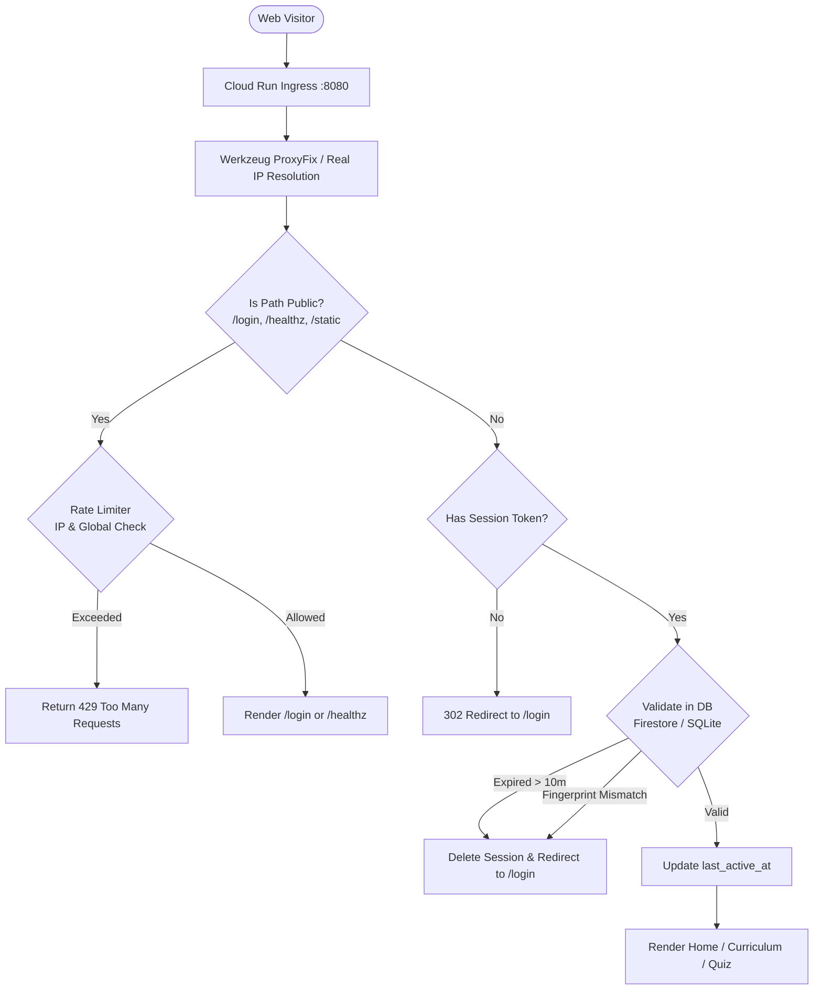

# Python Roadmap (`py-rm`)

> **"I made this to help my brother learn Python. Only users created by me can login."**  
> **Live Production URL:** [https://learn-python.cloud.run](https://learn-python.cloud.run)

---

## 📖 Executive Summary & Mission

`py-rm` is a personalized, distraction-free learning platform engineered specifically for a 13-year-old beginner starting his programming journey. 

Unlike public learning platforms that are noisy or saturated with social features, `py-rm` is private, structured, and goal-oriented. It delivers bite-sized milestones featuring:
- **Curated Topics**: Core Python fundamentals explained in clean, beginner-accessible language.
- **Handpicked Video Lessons**: Embedded YouTube tutorials to watch directly on the platform without YouTube recommendation distractions.
- **Interactive Checklists**: Real-time progress tracking to maintain momentum.
- **Quizzes**: Fun checkpoints to validate mastery after each module.

To protect the platform and ensure a focused environment, there is **zero public registration**. The application is locked behind a strict authentication barrier: the `/login` screen is the sole entry point exposed to the open internet.

---

## 🛠️ Technology Stack & Architecture

| Layer | Technology | Rationale & Architectural Benefit |
| :--- | :--- | :--- |
| **Backend Framework** | **Python 3.12 + Flask** | Written in the very language he is learning, turning the codebase into an educational artifact. Flask is lightweight, explicit, and fast to run. |
| **Frontend & UI** | **Jinja2 + Tailwind CSS** | Server-side rendered pages guarantee that unauthenticated visitors never receive internal HTML or data payloads. Styled with modern dark-mode components. |
| **Production Database** | **Google Cloud Firestore** | Serverless NoSQL document database. Zero configuration on Cloud Run, scales to zero with **\$0 idle cost**, and stays within GCP's permanent free tier (1 GB storage, 50k reads/day, 20k writes/day). |
| **Local / Fallback DB** | **SQLite 3** | Zero-dependency local relational engine. Enables instantaneous offline unit testing (14 tests in <4s) and serves as an automatic fail-safe if cloud networks are unreachable. |
| **Content Store** | **YAML / JSON** | Curriculum topics, video links, checklist items, and quiz questions live as structured repository files for easy version control without database migrations. |
| **Hosting & Compute** | **Google Cloud Run** | Fully managed serverless container runtime deployed in `asia-south1 (Mumbai)`. Configured with `max-instances=1` to guarantee cost control. |
| **WSGI Server** | **Gunicorn** | Production-grade WSGI server running with 1 worker and 8 threads for low memory usage and high concurrency. |
| **Containerization** | **Docker** | Uses `python:3.12-slim` for tiny container footprint, predictable builds, and fast Cloud Build deployments. |

---

## 🏛️ System Architecture & Request Lifecycle



---

## 📜 Step-by-Step Build Chronicle

This project was built incrementally, addressing cloud constraints, security boundaries, and architectural resilience at each milestone.

### Phase 1: Core Web Engine & Authentication Prototype
1. **Virtual Environment & Dependencies**: Initialized `.venv` with Python 3.12, pinned production dependencies (`Flask`, `Flask-Limiter`, `gunicorn`, `werkzeug`, `python-dotenv`).
2. **Reverse Proxy Integration**: Integrated `werkzeug.middleware.proxy_fix.ProxyFix` to correctly parse `X-Forwarded-For` and `X-Forwarded-Proto` headers behind Google Cloud's load balancers.
3. **Password Security**: Passwords are never stored in plain text. Implemented **scrypt** cryptographic hashing via `werkzeug.security.generate_password_hash`.
4. **Admin User Management CLI (`manage.py`)**: Built an administrative command-line utility to provision user credentials (`create-user`, `list-users`, `init-db`) without needing a web registration form.
5. **UI & Templates**:
   - `templates/base.html`: Common layout with Tailwind CSS loaded via CDN, custom dark palette (`bg-slate-950`), and floating notification flash banners.
   - `templates/login.html`: Distraction-free login card with username and password fields.
   - `templates/home.html`: Welcoming home screen displaying **"Hello!"**, the logged-in username, and a logout button.
6. **Containerization**: Authored a lean `Dockerfile` based on `python:3.12-slim` running Gunicorn on port `8080`, alongside a `.dockerignore` to keep repository build layers minimal.

---

### Phase 2: Google Cloud Run Deployment & Live Setup
1. **GitHub Connection**: Pushed codebase to `git@github.com:aourabindorout/py-rm.git`.
2. **Cloud Run Provisioning**:
   - **Service Name**: `py-rm`
   - **Region**: `asia-south1 (Mumbai)` for ultra-low latency.
   - **Authentication**: Set to *Allow unauthenticated invocations* (public access to container port `8080` so the public can hit the `/login` gateway; internal routes remain guarded by Flask).
   - **Billing Model**: *Request-based* (scales to 0 when idle so costs remain \$0).
   - **Critical Bill-Shock Guardrail**: Hard-capped **`max-instances = 1`**. Even under automated DDoS traffic, Cloud Run is forbidden from spinning up additional instances.
3. **Live Deployment**: Service went live at **`https://learn-python.cloud.run`**.

---

### Phase 3: Login Guardrails & Abuse Defense
To prevent automated credential stuffing, bot scraping, and billing spikes from internet crawlers:
1. **Application-Level Dual-Tier Rate Limiting (`Flask-Limiter`)**:
   - **`POST /login` (Credential Stuffing Defense)**:
     - **3 attempts / minute per IP**
     - **15 attempts / minute globally** across all visitors
   - **`GET /login` (Scraping & Flooding Defense)**:
     - **3 requests / minute per IP**
     - **25 requests / minute globally** across all visitors
2. **Custom Error UI (`templates/429.html`)**: Rate-limited visitors receive an informative HTTP 429 page explaining the cooldown period with a reload action.
3. **Timing-Attack Mitigation**: Rate limits evaluate *before* password hash computations, preventing CPU exhaustion attacks.

---

### Phase 4: Server-Side Session Tracking & Replay Attack Neutralization
* **The Vulnerability**: Flask's default sessions are stateless client-side signed cookies. If an attacker copied an active session cookie on another machine, clicking "Log Out" only deleted the cookie on the user's browser—the stolen cookie string remained cryptographically valid until expiration.
* **The Fix**:
  1. **Server-Side Session Store**: Created a `sessions` table/collection tracking `session_token`, `user_id`, `user_agent_hash`, `created_at`, and `last_active_at`.
  2. **Instant Revocation on Logout**: Clicking **Log Out** immediately purges the session token from the server-side database. Any copied cookie is rendered 100% dead.
  3. **10-Minute Inactivity Expiry**: Sessions enforce a sliding 10-minute inactivity window. If no requests are made for 600 seconds, the session auto-expires and is deleted from the database.
  4. **Device Fingerprint Binding**: Binds the session token to a SHA-256 hash of the client's `User-Agent`. Replaying the token from a different browser or OS terminates the session.

---

### Phase 5: Google Cloud Firestore Integration & Dual-Backend Fallback
1. **IAM Permissions**: Attached the `Cloud Datastore User` role to the Cloud Run Compute Service Account (`<project-number>-compute@developer.gserviceaccount.com`).
2. **Firestore Provisioning**: Created the `(default)` database in **Firestore Native Mode**, Standard Edition, located in `asia-south1 (Mumbai)`.
3. **Data Model Architecture**:
   - `users/{username}`: Direct document key lookup for $O(1)$ authentication checks.
   - `sessions/{session_token}`: Direct document key lookup for active session validation.
   - `progress/{username}`: Persistent storage for `completed_topics`, `checklist`, and `quiz_scores`.
4. **Self-Healing Dual-Backend Engine (`db.py`)**:
   - **Production (Cloud Run)**: Detects `K_SERVICE` or `GOOGLE_CLOUD_PROJECT` and operates directly against Google Cloud Firestore.
   - **Local / Testing**: Operates against local SQLite (`instance/py_rm.sqlite3`).
   - **Fault-Tolerant Exception Handling**: All Firestore operations are wrapped in safe fallbacks. If Firestore experiences network timeouts or configuration delays, the app falls back to local SQLite without crashing Gunicorn (permanently resolving the startup 503 "Service Unavailable" issue).

---

### Phase 6: Advanced Hardening & Vulnerability Remediation
1. **Cryptographic `SECRET_KEY` Generation**:
   - Removed the static fallback string `"py-rm-dev-secret-key-change-in-prod"`.
   - If `SECRET_KEY` is not provided in environment variables, the server dynamically generates an ephemeral 256-bit cryptographic key on startup (`secrets.token_hex(32)`), guaranteeing that session signatures can never be forged.
2. **Strict User-Agent Verification**:
   - Closed a vulnerability where requests omitting the `User-Agent` header bypassed fingerprint validation.
   - Requests without a `User-Agent` or with an empty string evaluate against `stored_ua_hash`, triggering immediate session revocation.
3. **CSRF Protection on Logout**:
   - Added synchronizer CSRF tokens (`session["csrf_token"] = secrets.token_hex(32)`).
   - Injected CSRF tokens into the logout form in `templates/home.html`.
   - `POST /logout` verifies tokens using `secrets.compare_digest`, neutralizing cross-origin logout DoS attacks from external websites.
4. **Emoji Favicon**: Injected an inline SVG data-URI favicon (`🐍`) into `templates/base.html`, replacing the browser's default globe icon with zero external asset dependencies.

---

## 🗄️ Database Schemas

### Firestore Document Structure (Production)
```
firestore/
├── users/
│   └── {username}                 # e.g. "brother"
│       ├── username: "brother"
│       ├── password_hash: "scrypt:32768:8:1$..."
│       └── created_at: 1730000000
│
├── sessions/
│   └── {session_token}            # 32-byte URL-safe string
│       ├── session_token: "..."
│       ├── user_id: "brother"
│       ├── user_agent_hash: "e3b0c442..."
│       ├── ip_address: "203.0.113.1"
│       ├── created_at: 1730000000
│       └── last_active_at: 1730000600
│
└── progress/
    └── {username}                 # e.g. "brother"
        ├── completed_topics: ["intro", "variables"]
        ├── checklist: {"intro_vid_1": true, "vars_ex_1": true}
        ├── quiz_scores: {"quiz_1": {"score": 5, "total": 5, "passed": true, "timestamp": 1730001000}}
        └── updated_at: 1730001000
```

### SQLite Schema (Local Development & Fallback)
```sql
CREATE TABLE IF NOT EXISTS users (
    id INTEGER PRIMARY KEY AUTOINCREMENT,
    username TEXT UNIQUE NOT NULL COLLATE NOCASE,
    password_hash TEXT NOT NULL,
    created_at TIMESTAMP DEFAULT CURRENT_TIMESTAMP
);

CREATE TABLE IF NOT EXISTS sessions (
    id INTEGER PRIMARY KEY AUTOINCREMENT,
    session_token TEXT UNIQUE NOT NULL,
    user_id TEXT NOT NULL,
    user_agent_hash TEXT,
    ip_address TEXT,
    created_at INTEGER NOT NULL,
    last_active_at INTEGER NOT NULL
);

CREATE TABLE IF NOT EXISTS progress (
    id INTEGER PRIMARY KEY AUTOINCREMENT,
    username TEXT UNIQUE NOT NULL COLLATE NOCASE,
    data_json TEXT NOT NULL DEFAULT '{}',
    updated_at INTEGER NOT NULL
);
```

---

## 🛡️ Security & Guardrail Matrix

| Threat Vector | Mechanism / Defense Layer | Implementation Location |
| :--- | :--- | :--- |
| **Billing Blowout / Resource Exhaustion** | Cloud Run hard limit: `max-instances=1` | Google Cloud Run configuration |
| **Brute Force & Credential Stuffing** | 3 attempts/min per IP, 15 attempts/min global ceiling | `Flask-Limiter` on `POST /login` |
| **Scraper / Bot Flooding** | 3 requests/min per IP, 25 requests/min global ceiling | `Flask-Limiter` on `GET /login` |
| **Password Database Breach** | **scrypt** cryptographic hashing with unique salt | `db.py` via `werkzeug.security` |
| **Cookie Replay Attack (Stolen Cookie)** | Server-side token storage + immediate DB deletion on logout | `db.py:delete_session` |
| **Session Hijacking / Device Theft** | SHA-256 browser `User-Agent` fingerprint matching | `db.py:validate_and_refresh_session` |
| **Omitted User-Agent Bypass** | Strict equality check rejects missing or empty headers | `db.py:validate_and_refresh_session` |
| **Unattended Device Session Abandonment** | 10-minute sliding inactivity timeout auto-purges token | `db.py:INACTIVITY_TIMEOUT_SECONDS` |
| **Cross-Site Request Forgery (Logout DoS)** | Synchronizer CSRF token validation with `compare_digest` | `app.py:logout` & `templates/home.html` |
| **Unauthorized Endpoint Access** | `@app.before_request` barrier; all non-whitelisted routes 302 to `/login` | `app.py:enforce_authentication` |
| **Secret Key Forgery** | High-entropy 256-bit dynamic generation fallback | `app.py:app.secret_key` |

---

## 🧪 Automated Testing Suite (`test_auth.py`)

The project includes an automated test suite covering all security constraints and workflows:

| Test Case | Scenario Verified | Result |
| :--- | :--- | :--- |
| `test_unauthenticated_redirects_to_login` | Accessing `/` without session returns 302 to `/login` | ✅ Passed |
| `test_healthz` | Cloud Run health check endpoint returns 200 OK | ✅ Passed |
| `test_login_failed` | Incorrect credentials return error message | ✅ Passed |
| `test_login_success_and_home_display` | Valid credentials establish session and display "Hello!" | ✅ Passed |
| `test_logout` | Legitimate user logging out with CSRF token succeeds | ✅ Passed |
| `test_logout_csrf_protection` | External POST to `/logout` without valid CSRF is rejected (403) | ✅ Passed |
| `test_logout_invalidates_server_session` | Extracted cookie reused after logout is rejected (token destroyed) | ✅ Passed |
| `test_inactivity_timeout_after_10_minutes` | Requests after 10m inactivity expire and redirect to `/login` | ✅ Passed |
| `test_user_agent_mismatch_blocks_replay` | Cookie used from a different browser is terminated | ✅ Passed |
| `test_missing_user_agent_blocks_replay` | Attacker stripping `User-Agent` via curl/script is terminated | ✅ Passed |
| `test_rate_limit_per_ip_get` | 4th GET request to `/login` from same IP within 1m returns 429 | ✅ Passed |
| `test_rate_limit_per_ip_post` | 4th POST request to `/login` from same IP within 1m returns 429 | ✅ Passed |
| `test_rate_limit_global_post` | 16th POST attempt across distinct IPs within 1m returns 429 | ✅ Passed |
| `test_progress_tracking` | Checklist milestones, topics, and quiz score mutations persist | ✅ Passed |

**Execution**:
```bash
.venv/bin/python test_auth.py
# Ran 14 tests in 3.7s -> OK
```

---

## 💻 Local Development Guide

### 1. Setup Virtual Environment
```bash
python3 -m venv .venv
source .venv/bin/activate
pip install -r requirements.txt
```

### 2. User Management CLI
```bash
# Create or update an account
python manage.py create-user brother mypassword123

# List existing accounts
python manage.py list-users
```

### 3. Run Locally
```bash
python app.py
# Access locally at http://localhost:8080
```

### 4. Run Automated Tests
```bash
python test_auth.py
```

---

## 🗺️ Next Milestones: Building the Curriculum
With the authentication barrier, database persistence, session security, and guardrails established, the next phase will build:
1. **Curriculum Engine**: Structured YAML/JSON files defining Python milestones (Variables, Loops, Functions, Lists, Dicts).
2. **YouTube Video Embeds**: Focused video player components embedded directly within each milestone.
3. **Interactive Checklists**: Real-time checklist toggles hooked to the Firestore progress API.
4. **Quiz Engine**: Interactive multi-choice checkpoints verifying comprehension before unlocking subsequent topics.
